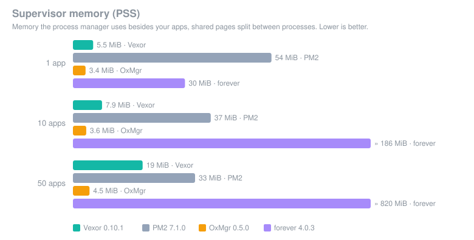
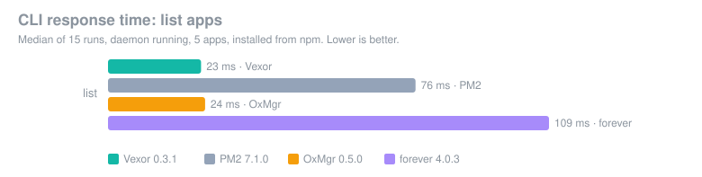
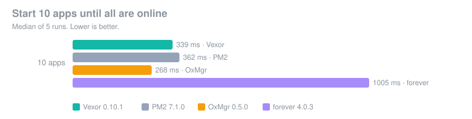
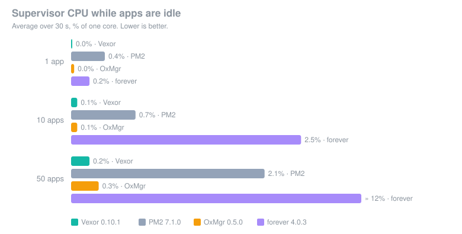
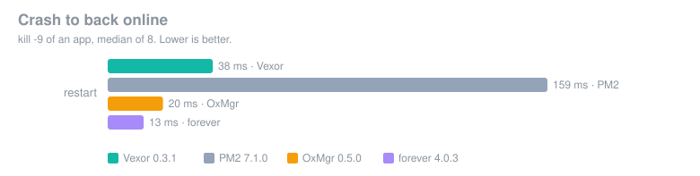
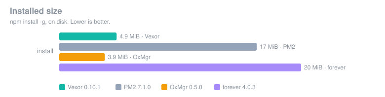

<div align="center">

# Vexor

**The production process manager for Node.js: a faster, safer upgrade to PM2.**

Written in Rust. Runs your PM2 ecosystem files as they are, keeps apps running
even when the supervisor crashes, and moves your apps off PM2 with one
reversible command.

[](https://www.npmjs.com/package/vexord)
[](https://github.com/gauravgitgithub/vexor/actions/workflows/ci.yml)
[](#license)


```sh
npm install -g vexord
```

[Why Vexor](#why-vexor) · [Benchmarks](#benchmarks) · [Compare](#vexor-vs-pm2-oxmgr-and-forever) · [Migrate from PM2](#migrate-from-pm2-in-four-commands) · [FAQ](#faq)

</div>

## What is Vexor?

Vexor is an open-source process manager for Node.js applications in
production: it starts your apps, keeps them running, restarts them when they
crash, runs them in cluster mode across CPU cores, reloads them without
downtime, and manages their logs. It is compatible with PM2: the same
`ecosystem.config.js`, the same commands (`start`, `stop`, `restart`,
`reload`, `logs`, `save`, `startup`), and a built-in migration from PM2 with
a dry run, a backup and a rollback.

Unlike PM2, Vexor's supervisor is a single static binary written in Rust: it
doesn't need Node.js to run, uses a fraction of PM2's memory, and answers
commands several times faster. Each app has its own small supervisor, so your
apps keep running and stay managed even if the main daemon crashes or is
upgraded.

> **Status: prerelease (0.10).** Used for evaluation and real migrations;
> see the [changelog](CHANGELOG.md) and the [known limits](#is-vexor-production-ready).

## Why Vexor

- **Your apps survive the supervisor.** Kill the Vexor daemon with `kill -9`
  and your apps keep serving and stay managed: 0 failed requests in our
  test, against 739 failed requests and a lost app with PM2.
- **A fast CLI.** `vexor ls` answers in 23 ms; `pm2 ls` takes 76 ms.
- **Light.** 5.7 MiB of supervisor memory for one app against PM2's 33 MiB,
  idle CPU close to zero, and a 5.8 MiB install against PM2's 17 MiB.
- **Zero-downtime reloads.** New processes start and must be healthy before
  the old ones are retired; a failed reload keeps the old processes.
- **Built-in health checks** (HTTP or TCP): an app is ready when its first
  check passes and is restarted when it stops answering. PM2 has no
  built-in HTTP health checks.
- **One log timeline.** `vexor logs` merges every app's output by time, each
  line with its timestamp, the app name in its own colour and stderr marked.
  JSON logs (pino, winston) are shown as level, message and fields.
- **Safe migration from PM2.** `vexor migrate --from-pm2` plans the move,
  backs up PM2's state, moves apps one at a time, puts any app that fails
  back on PM2, and can roll everything back.
- **Runs any Node.js version.** Apps on Node 8 through 24 are tested in CI;
  the supervisor itself needs no Node at all.
- **Alerts without a SaaS.** Crash loops, restart storms, failing health
  checks and filling log disks open incidents out of the box; CPU and
  memory thresholds are one line. Delivered by email or signed webhook
  (Slack format included), with flap damping. PM2 sells alerting in PM2
  Plus.
- **Secure by default.** State and logs are private to your user (0600),
  apps get an allowlisted environment unless you ask for the whole shell's,
  `describe` hides environment values, and release binaries ship with
  SHA-256 checksums, an SBOM and build provenance.

## Install

```sh
npm install -g vexord          # installs the `vexor` command
```

Without npm or Node.js (verifies the SHA-256 checksum before installing):

```sh
curl -fsSL https://raw.githubusercontent.com/gauravgitgithub/vexor/main/install.sh | sh
```

Prebuilt for Linux x64 and arm64 (static, any distribution) and macOS arm64
and x64. No install scripts run during `npm install`.

## Quick start

```sh
vexor start app.js -i 4            # cluster mode, 4 instances
vexor start ecosystem.config.js    # PM2 ecosystem files work as they are
vexor ls                           # status, CPU, memory, uptime, restarts
vexor logs -f                      # one timeline of every app's logs
vexor reload app                   # new processes first, then retire the old
vexor describe app                 # configuration, status, recent events
vexor metrics app --since 6h       # CPU, memory, restarts over time
vexor alerts                       # open incidents and alert rules
vexor signal SIGUSR2 app           # PM2 sendSignal; also flush, kill
vexor scale app +2                 # PM2 scale: only the difference starts or stops
vexor monit                        # live view: CPU, memory, health, alerts, logs
vexor doctor                       # what's wrong with the setup, and how to fix it
vexor startup                      # start at boot (systemd, launchd)
```

## Migrate from PM2 in four commands

```sh
pm2 save                           # make PM2's saved list current
vexor migrate --from-pm2           # dry run: the plan, changes nothing
vexor migrate --from-pm2 --backup  # back up PM2's state and the plan
vexor migrate --from-pm2 --apply   # move apps one at a time
```

The dry run shows, for each app, whether it can move and what needs your
attention (an app PM2 keeps restarting, a missing script, a readable dump
file). `--apply` stops each app under PM2, starts it under Vexor, and waits
until it is healthy; an app that isn't goes straight back to PM2. Changed
your mind? `vexor migrate --rollback` moves everything back. Each running
app is down for about its start-up time while it moves. Details:
[docs/migration.md](docs/migration.md).

## Benchmarks

Vexor 0.3.1 against PM2 7.1.0, OxMgr 0.5.0 (another Rust process manager)
and forever 4.0.3, each installed from npm and run alone on the same apps
in one Linux container. Every number below was measured; the harness is in
[`benchmarks/`](benchmarks/) and the raw results are
[committed](benchmarks/results/2026-10-23-apple-m5-docker/results.json).

<p align="center">
  <br>
  <br>
  <br>
  <br>
  <br>
  
</p>

Measured 2026-10-23 on Apple M5 (Docker Desktop VM) (10 cores, 8 GB), linux/arm64 7.0.12-linuxkit, in a container, Node v22.23.4. Each tool runs alone, installed from npm, on the same apps. **Bold** = best; n/a = not supported or failed (see notes).

| Measure | Vexor 0.3.1 | PM2 7.1.0 | OxMgr 0.5.0 | forever 4.0.3 |
|---|---|---|---|---|
| List apps (CLI), median | **23 ms** | 76 ms | 24 ms | 109 ms |
| Start 10 apps until online, median | 352 ms | 435 ms | **317 ms** | 1268 ms |
| Supervisor memory (PSS), 1 app | 5.7 MiB | 33 MiB | **3.5 MiB** | 37 MiB |
| Supervisor memory (PSS), 10 apps | 7.9 MiB | 21 MiB | **5.7 MiB** | 191 MiB |
| Supervisor memory (PSS), 50 apps | 17 MiB | 21 MiB | **4.6 MiB** | 825 MiB |
| Supervisor memory (RSS), 1 app | 8.1 MiB | 66 MiB | **3.5 MiB** | 67 MiB |
| Supervisor memory (RSS), 10 apps | 33 MiB | 68 MiB | **5.7 MiB** | 675 MiB |
| Supervisor memory (RSS), 50 apps | 140 MiB | 72 MiB | **4.6 MiB** | 3316 MiB |
| Supervisor CPU while idle, 1 app | **0.00%** | 0.37% | 0.07% | 0.37% |
| Supervisor CPU while idle, 10 apps | **0.00%** | 0.70% | 0.07% | 2.26% |
| Supervisor CPU while idle, 50 apps | 0.33% | 1.50% | **0.17%** | 7.48% |
| Crash to back online, median | 38 ms | 159 ms | 20 ms | **13 ms** |
| Failed requests in 5 cluster reloads | **0** | **0** | **0** | n/a |
| Supervisor daemon killed: failed requests | **0** | 739 | **0** | n/a |
| Supervisor daemon killed: app still managed | **yes** | no | **yes** | n/a |
| Installed size (npm) | 5.8 MiB | 17 MiB | **3.9 MiB** | 20 MiB |

Requests sent: reloads Vexor 1615, PM2 1726, OxMgr 1645, forever 0; daemon kill Vexor 1239, PM2 1219, OxMgr 1220, forever 0.

Notes:
- OxMgr, crash_restart_ms: Measured separately: OxMgr marks an app errored after its 3rd crash by default (crash_restart_limit 3), even with uptime between crashes, so only 3 restarts can be timed.

**Where Vexor wins.** Against PM2: 3× faster CLI, about 6× less supervisor
memory for one app, less idle CPU, faster starts, faster crash recovery, a
third of the install size, and the app keeps running and stays managed when
the supervisor is killed (PM2 lost the app and 739 requests). Against
forever: on every measure Vexor supports, and forever has no cluster mode,
reload or daemon.

**Where Vexor loses, and what we're doing about it.**

- **Memory against OxMgr.** OxMgr runs one daemon for all apps; Vexor runs a
  small supervisor (shim) per app, which is what keeps apps managed when the
  daemon dies. Measured as PSS, Vexor uses 17 MiB at 50 apps (PM2 21 MiB,
  OxMgr 4.6 MiB); measured as RSS, which counts the shared binary once per
  shim, 140 MiB. Shrinking the per-app shim is on the roadmap.
- **Crash restarts** take 38 ms, against 13 ms for forever and 20 ms for
  OxMgr (PM2: 159 ms). Note that OxMgr, by default, stops restarting an app
  after its 3rd crash, even when it ran for seconds in between.
- **Install size and start time:** OxMgr is smaller (3.9 MiB) and slightly
  faster to start 10 apps (317 ms against 352 ms).
- **Windows:** PM2, OxMgr and forever run on Windows; Vexor doesn't yet.

Methodology and how to reproduce: [docs/benchmarks.md](docs/benchmarks.md).

## Vexor vs PM2, OxMgr and forever

| | Vexor | PM2 | OxMgr | forever |
|---|---|---|---|---|
| Runs PM2 `ecosystem.config.js` as is | ✓ | ✓ | ~ ¹ | ✗ |
| Migrates running PM2 apps (plan, backup, apply, rollback) | ✓ | – | ✗ ² | ✗ |
| Cluster mode (shared port across CPU cores) | ✓ | ✓ | ✓ | ✗ |
| Zero-downtime reload, health-gated | ✓ | ✓ | ✓ | ✗ |
| Apps keep running and stay managed if the daemon is killed | ✓ ³ | ✗ ³ | ✓ ³ | – |
| HTTP/TCP health checks | ✓ | ✗ | command checks | ✗ |
| Restart on memory limit / cron / file change | ✓ / ✓ / ✓ | ✓ / ✓ / ✓ | ✓ / ✓ / ✓ | ✗ / ✗ / ✓ |
| Built-in log rotation | ✓ | module (pm2-logrotate) | ✓ | ✗ |
| One merged, timestamped log timeline | ✓ | per app ⁴ | ✗ | ✗ |
| Start at boot (systemd, launchd) | ✓ | ✓ | ✓ | ✗ |
| Supervisor needs no Node.js | ✓ | ✗ | ✓ | ✗ |
| Windows | ✗ | ✓ | ✓ | ✓ |
| License | MIT or Apache-2.0 | AGPL-3.0 | MIT | MIT |

✓ supported · ✗ not supported · ~ partly · – not applicable.
¹ In our test, importing a PM2 ecosystem file with `.js` scripts failed ("failed to spawn"); `node script.js` commands work.
² OxMgr converts ecosystem files; it doesn't document moving apps from a running PM2 with rollback.
³ Measured: `kill -9` of the daemon under HTTP load (see [Benchmarks](#benchmarks)).
⁴ `pm2 logs` interleaves apps; lines carry timestamps only with `time: true` or `log_date_format`.
OxMgr and forever capabilities are from their documentation and CLI help (OxMgr 0.5.0, forever 4.0.3) and our tests.

## Features

| | |
|---|---|
| Process management | fork and cluster mode, instances, restart with backoff and crash-loop limit, `stop_exit_codes`, graceful stop with `kill_timeout` and a configurable signal |
| Zero downtime | `reload`: new processes first, healthy before the old ones retire; failed reloads keep the old processes |
| Health | `wait_ready` (`process.send('ready')`), HTTP/TCP health checks, `max_memory_restart`, `cron_restart`, `watch` |
| Logs | timestamped lines, one merged timeline, built-in rotation (10 MiB × 5 by default), back-pressure control |
| Reliability | per-app supervisors survive daemon crashes and upgrades; PID identity checks against PID reuse; orphaned descendants cleaned up |
| PM2 compatibility | ecosystem files (`.js`, `.cjs`, `.mjs`, `.json`), `vexor check` lists every unsupported setting before you start, conformance-tested against PM2 7 |
| Operations | `save`/`resurrect`, `startup` for systemd and launchd, `describe`, `events` history, `--json` everywhere |

## FAQ

### What is the best alternative to PM2?

If you want to keep PM2's ecosystem files and commands but need a lighter,
faster supervisor whose crashes don't take your apps with it, Vexor is
built for that, and it migrates your PM2 apps for you. For apps that only
need restarts on one Linux host, plain systemd units are also an option,
without cluster mode or log management.

### Is Vexor a drop-in replacement for PM2?

For most setups, yes: the same ecosystem files and commands work. Run
`vexor check ecosystem.config.js` to see any setting Vexor handles
differently or doesn't support: every PM2 field is now either supported
or reported (for example `uid`/`gid` need Vexor running as root, as in PM2). Differences are documented in
[docs/compatibility.md](docs/compatibility.md) and checked against PM2 7 in
[docs/conformance.md](docs/conformance.md).

### How do I migrate from PM2 to Vexor?

`pm2 save`, then `vexor migrate --from-pm2` (a dry run), `--backup`, and
`--apply`. Apps move one at a time and any app that isn't healthy under
Vexor goes back to PM2. `vexor migrate --rollback` undoes the migration.

### Does Vexor support cluster mode and zero-downtime reloads?

Yes. `vexor start app.js -i 4` (or `exec_mode: "cluster"`) runs Node's
cluster mode, sharing the port between instances. `vexor reload` starts new
workers, waits until they are ready, then retires the old ones; our tests
saw 0 failed requests across repeated reloads under load.

### What happens if the Vexor daemon crashes?

Nothing visible to your apps. Each app is supervised by its own small
process (a shim); the daemon only coordinates. A new daemon reconnects to
the running apps. In our test, `kill -9` of the daemon caused 0 failed
requests and the app stayed managed.

### Which Node.js versions does Vexor support?

Apps on Node.js 8 through 24 are tested in CI. The `vexor` supervisor is a
native binary and needs no Node.js; the npm launcher needs Node 10 or newer,
and `install.sh` installs without Node.

### Does Vexor run on Windows?

Not yet. Linux (x64, arm64) and macOS (arm64, x64) are supported.

### Is Vexor production ready?

Vexor is a prerelease (0.3). It is tested in CI on Linux and macOS, against
real PM2 for compatibility, and through real migrations, and its weak points
are published with the [benchmarks](#benchmarks). Try it on a staging host
first, and keep PM2's rollback path until you are confident.

### Is Vexor free?

Yes: open source under MIT or Apache-2.0, with no paid tier. Health checks,
log rotation and the event history are built in.

## Documentation

[Architecture](docs/architecture.md) ·
[Compatibility with PM2](docs/compatibility.md) ·
[PM2 conformance results](docs/conformance.md) ·
[Migration](docs/migration.md) ·
[Benchmarks and methodology](docs/benchmarks.md) ·
[Security](docs/security.md) ·
[Roadmap](docs/plan.md) ·
[Changelog](CHANGELOG.md)

## Development

The toolchain is pinned in `rust-toolchain.toml`.

```sh
cargo fmt --all --check
cargo clippy --workspace --all-targets --locked -- -D warnings
cargo test --workspace --locked
cargo deny check all          # needs cargo-deny
```

## License

Licensed under either of [Apache License 2.0](LICENSE-APACHE) or
[MIT license](LICENSE-MIT), at your option.
